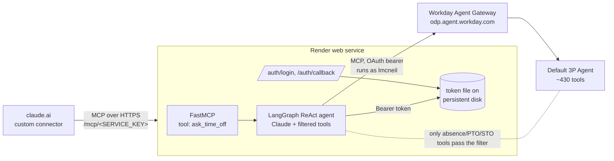

# pandalai-workday-pto-langgraph

A small **LangGraph agent** that answers PTO / STO / absence questions by calling the **Workday Default 3P Agent** (an MCP server) in tenant `wxqmdmpnjn_extdev`, deployed on **Render**. **claude.ai talks to this service, not to Workday.** The service is the only thing that holds Workday access, so more (non-Workday) agents can be added behind the same front door later.

No Composio is used anywhere.



## Behaviour

- One MCP tool is exposed to claude.ai: `ask_time_off(question, confirm_writes=false)`.
- The agent is a LangGraph `create_react_agent` using an Anthropic Claude model. At each call it lists the Workday agent's tools, **keeps only those matching `TOOL_ALLOW_REGEX` and not `TOOL_DENY_REGEX`**, and hands those to the model.
- **Read-only by default.** Tools matching `TOOL_WRITE_REGEX` (request/book/cancel/...) are offered only when `ENABLE_WRITE_TOOLS=true` **and** the caller passes `confirm_writes=true`, which claude.ai should do only after the user agrees to a specific booking.
- **Always the same Workday user (`lmcneil`).** The Workday agent runs in Delegate mode, so calls run as whoever signed in. The service signs in once and stores the tokens.

## Verified vs not verified

Verified locally (tests and a live local run):
- Tool filter and read/write split (`tests/test_core.py`).
- PKCE login URL, state handling, token store (file mode 0600), refresh logic.
- Server: `/healthz`, admin routes return 404 without `ADMIN_KEY`, MCP endpoint returns 404 on a wrong key, `tools/list` over MCP shows `ask_time_off`, and the "not connected" message is returned before sign-in.
- Request keys never appear in server logs.
- Workday's OAuth metadata (`/.well-known/oauth-authorization-server/wxqmdmpnjn_extdev`) was read live: authorization code + PKCE (S256), client secret in the POST body.

**Not yet verified** (needs your Workday client secret, an Anthropic key and a deployed service):
- A real sign-in, token exchange and refresh against Workday. Workday's metadata does not list a refresh-token grant, so it is unknown whether a refresh token is issued or how long the access token lasts. If there is no refresh token, the service tells you to sign in again when the token expires.
- The default tool-name regexes. The Workday tool names were not visible without a token, so the defaults are a best guess. Use `/admin/tools` after sign-in to see every tool and what passed.
- An end-to-end answer from the agent, and the claude.ai connector.

## Deploy to Render

1. In Render: **New > Blueprint**, pick this repo (`render.yaml` is picked up). The service uses a **paid** instance (`starter`) because it needs a persistent disk for the token file.
2. When prompted, set the secrets: `WORKDAY_CLIENT_ID`, `WORKDAY_CLIENT_SECRET` (from the Workday agent's **Credentials** tab) and `ANTHROPIC_API_KEY`. `SERVICE_KEY` and `ADMIN_KEY` are generated by Render; read them from the service's **Environment** tab.
3. Note the service URL, for example `https://pandalai-workday-pto.onrender.com`. `PUBLIC_BASE_URL` defaults to Render's `RENDER_EXTERNAL_URL`.
4. In Workday: **Agent Management Hub > Agent Registry > Default 3P Agent > Credentials**, add the Redirect URI `https://<your-service>.onrender.com/auth/callback`. The claude.ai redirect (`https://claude.ai/api/mcp/auth_callback`) is not needed for this service. If Workday allows only one Redirect URI per agent, either replace it or register a second agent for this service.
5. Sign in once as `lmcneil`: open `https://<your-service>.onrender.com/auth/login?key=<ADMIN_KEY>` in a browser. After the Workday sign-in you see "Workday connected".
6. Check `https://<your-service>/auth/status?key=<ADMIN_KEY>` (shows connection state and expiry, never tokens), then `https://<your-service>/admin/tools?key=<ADMIN_KEY>` to review which tools passed the filter. Adjust `TOOL_ALLOW_REGEX` / `TOOL_DENY_REGEX` in Render and redeploy until only PTO/STO/absence tools are in `read` (and `write`).
7. In claude.ai add a custom connector with URL `https://<your-service>.onrender.com/mcp/<SERVICE_KEY>`. No OAuth settings are needed on the claude.ai side.

## Dedicated read-only Workday agent (hard boundary)

The Default 3P Agent holds ~434 tools, and the regex filter only limits what *this service* offers. To make the limit real, a second agent, **PTO Time Off Agent**, was registered in the tenant with only 8 read-only tools:
`find_absence_balances`, `find_holiday_calendar`, `find_worker_eligible_absence_types`, `find_worker_time_off_details`, `find_worker_valid_time_off_dates`, `list_time_off_entry_statuses`, `list_leave_event_statuses`, `find_staffing_workers`.

- Registered with `POST https://api.odp.wcp.workday.com/asor/v1/agentDefinition` (header `wd-agent-tenant-alias: wxqmdmpnjn_extdev`), body in `registration/pto-agent-definition.json`. Tool IDs were copied from the Default 3P Agent's own definition (`GET /asor/v1/agentDefinition/<id>`), so they are exact for this tenant.
- The ASOR calls need the Developer Site **Copy Token** (`wdcli` tokens are rejected). Save it from the clipboard without printing it: `umask 077; pbpaste | tr -d '[:space:]' > ~/.asor_token`, and delete the file afterwards.
- Write tools (`create_worker_time_off_request`, `update_worker_time_off_entry`, leave-of-absence request) are deliberately left out. Add them to the skill and re-POST (same name and version updates it) only when booking is wanted.
- In Workday: Agent Registry > PTO Time Off Agent > Credentials: set the Redirect URI to `https://pandalai-workday-pto.onrender.com/auth/callback`, generate a client secret, then Configure Agent (Available To, enable the skill) and Activate. Put that agent's client ID/secret into Render as `WORKDAY_CLIENT_ID` / `WORKDAY_CLIENT_SECRET`. The Default 3P Agent keeps the claude.ai Redirect URI.

## Calling it from Google ADK

The endpoint is a plain MCP server, so any MCP client works, including Google ADK. `examples/adk_client.py` connects with ADK's `McpToolset` and either lists the tools (no LLM key needed) or runs a small ADK agent:

```bash
python3 -m venv .venv-adk && . .venv-adk/bin/activate && pip install -r examples/requirements.txt
# copy SERVICE_KEY from Render to the clipboard first, so it never appears on screen
PTO_SERVICE_KEY=$(pbpaste | tr -d '[:space:]') python examples/adk_client.py
PTO_SERVICE_KEY=$(pbpaste | tr -d '[:space:]') GOOGLE_API_KEY=... python examples/adk_client.py --ask "What are my PTO and STO balances?"
```

Notes: ADK sees one tool, `ask_time_off`. The reasoning inside it still runs on Claude (Anthropic key on Render). Every caller that uses the URL acts as the signed-in Workday user, so separate callers cannot be told apart or revoked individually unless multiple keys are added.

## Configuration

| Variable | Purpose |
|---|---|
| `WORKDAY_TENANT` | Tenant alias, default `wxqmdmpnjn_extdev` |
| `WORKDAY_CLIENT_ID` / `WORKDAY_CLIENT_SECRET` | OAuth client from the agent's Credentials tab |
| `WORKDAY_MCP_URL` | Override the gateway MCP URL (default `https://odp.agent.workday.com/<tenant>/mcp`) |
| `SERVICE_KEY` | Secret path segment in the claude.ai connector URL |
| `ADMIN_KEY` | Protects `/auth/login`, `/auth/status`, `/admin/tools` |
| `TOKEN_STORE_PATH` | Token file, default `/data/workday_token.json` (the persistent disk) |
| `ANTHROPIC_API_KEY`, `MODEL` | LLM for the LangGraph agent (default `claude-sonnet-5-5`) |
| `TOOL_ALLOW_REGEX`, `TOOL_DENY_REGEX`, `TOOL_WRITE_REGEX` | Which Workday tools the agent may see, and which count as writes |
| `ENABLE_WRITE_TOOLS` | `true` to allow booking tools when the caller sets `confirm_writes=true` |

## Security notes

- **The secret URL is the credential.** Anyone with `https://.../mcp/<SERVICE_KEY>` can ask questions as `lmcneil`. Treat it like a password and rotate `SERVICE_KEY` in Render if it leaks. Access logging is turned off so the key never lands in Render logs.
- The tool filter limits what the **agent** can call, but the Workday token can still call every tool on that Workday agent. For a hard boundary, register a separate Workday agent whose skill contains only the absence tools and point this service at it (`WORKDAY_CLIENT_ID/SECRET` and `WORKDAY_MCP_URL`).
- Keep the Workday client secret and Anthropic key only in Render env vars. They are not in this repo.
- Question text and Workday answers pass through Anthropic's API, as with any LLM agent. Only time-off data is requested.
- The service is single-instance by design (OAuth state in memory, token on one disk).

## Local development

```bash
python3 -m venv .venv && . .venv/bin/activate
pip install -r requirements-dev.txt
python -m pytest -q tests
cp .env.example .env   # fill in, then: set -a; . ./.env; set +a
uvicorn app.server:app --port 8000 --no-access-log
```
For a local sign-in, set `PUBLIC_BASE_URL=http://localhost:8000` and register `http://localhost:8000/auth/callback` as a Redirect URI on the Workday agent.

## Layout

| Path | Purpose |
|---|---|
| `app/server.py` | ASGI app: key-protected MCP endpoint, auth and admin routes |
| `app/agent.py` | Tool discovery, filter, LangGraph agent |
| `app/workday_auth.py` | OAuth code + PKCE, token store, refresh |
| `app/config.py` | Environment settings and default filters |
| `render.yaml` | Render Blueprint (web service + 1 GB disk) |
| `tests/test_core.py` | Unit tests |

## Extending later

Add more tools to the MCP server in `app/server.py`, or replace `agent.ask` with a LangGraph supervisor that routes between this Workday time-off agent and other agents that do not use Workday. The Workday part stays isolated in `app/workday_auth.py` and `app/agent.py`.
