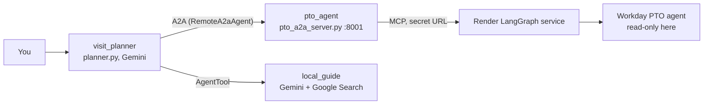

# A2A example: plan a local visit for your PTO day

Two Google ADK programs that talk over the **A2A (Agent2Agent)** protocol.



1. `pto_a2a_server.py` wraps the Render service's `ask_time_off` MCP tool in an ADK agent and publishes it as an A2A server (agent card at `/.well-known/agent-card.json`). A `before_tool_callback` forces `confirm_writes=False`, so nothing can be booked through this endpoint.
2. `planner.py` is the client. It discovers the PTO agent through its card, asks it for your next PTO day, then asks a Google-Search-grounded `local_guide` for places near your city and writes a short plan.

**Privacy:** only the city and the date/weekday go to the search step. Balances and other Workday details stay with the PTO agent.

## Run it (two terminals)

```bash
python3 -m venv .venv-adk && . .venv-adk/bin/activate
pip install -r examples/requirements.txt a2a-sdk
# keys via the clipboard/files so they never appear on screen
```

Terminal 1, the A2A server (keep it running):
```bash
PTO_SERVICE_KEY=$(pbpaste | tr -d '[:space:]') GOOGLE_API_KEY=$(cat ~/.gemini_key) python examples/a2a/pto_a2a_server.py
```
Terminal 2, the planner:
```bash
GOOGLE_API_KEY=$(cat ~/.gemini_key) python examples/a2a/planner.py --city "Boston, MA"
```

Settings: `PTO_A2A_PORT` (default 8001), `PTO_A2A_URL` (planner, default `http://localhost:8001`), `ADK_MODEL` (default `gemini-3.8-flash`), `PTO_BASE_URL`.

## Notes

- Starting the server looks up the MCP tools to build the agent card, so it needs a valid `PTO_SERVICE_KEY` (a wrong one logs `Failed to create MCP session: Not Found`).
- If there is no upcoming PTO day, the planner says so and stops; it does not invent dates.
- To go further, `to_a2a(visit_planner)` would publish the planner itself as an A2A agent, and the PTO server could move to its own host.
